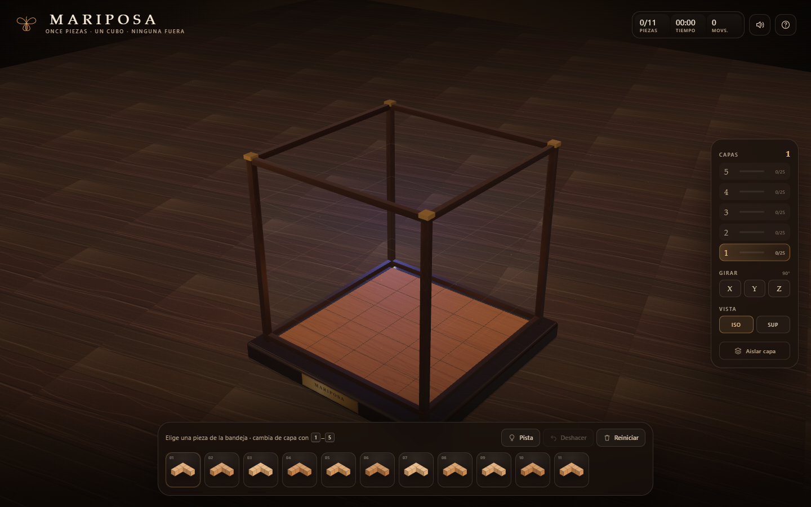
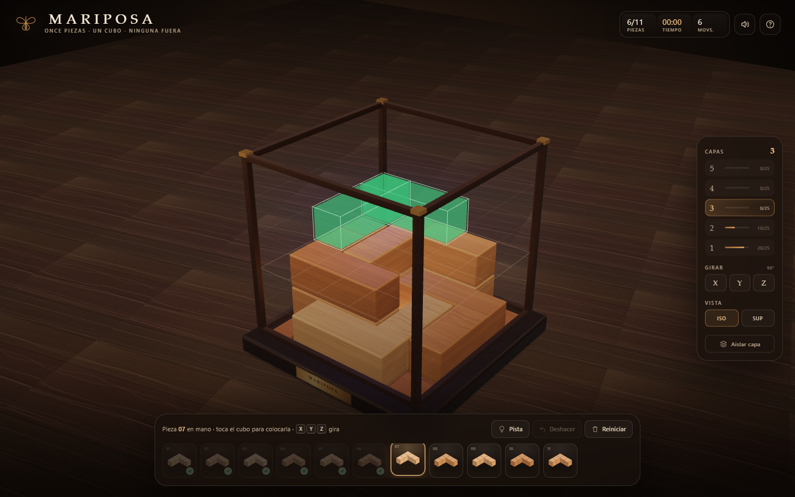
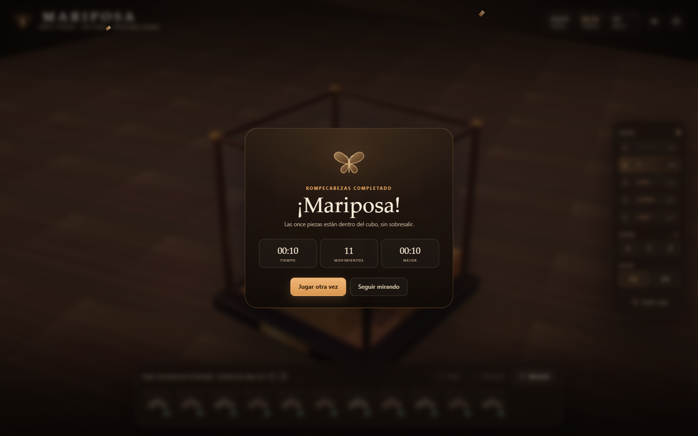
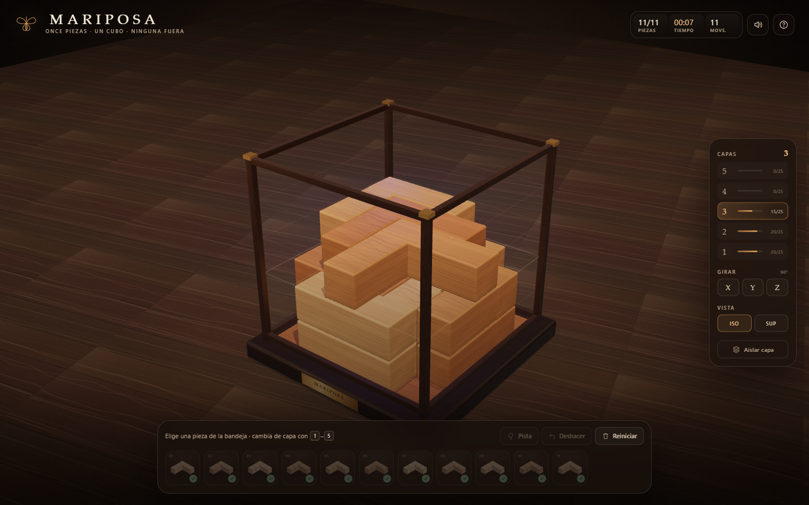
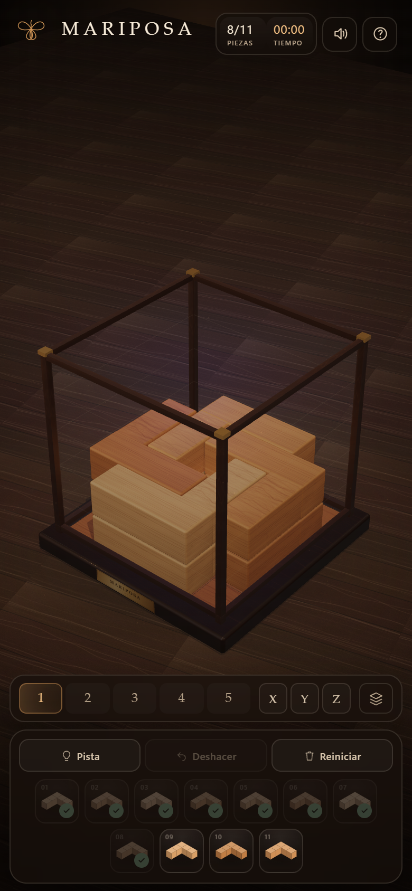

# MARIPOSA

**Rompecabezas 3D · cubo de 5 × 5 × 5 · once piezas en L**



Mariposa es un juego web en 3D: hay un cubo de madera de 5 × 5 × 5 y once piezas
en L. La meta es acomodar las once piezas dentro del cubo, sin que se solapen y
sin que ninguna sobresalga.

La idea nace de las fotos del cubo y de la pieza en L que compartiste. La
interpretación implementada es la que confirmaste: cada pieza ocupa **5 cubos**
(dos brazos de 3 unidos en ángulo recto, compartiendo la esquina) y puede girar
en las tres dimensiones.

---

## Cómo se juega

1. **Elige una pieza** en la bandeja inferior.
2. Mueve el puntero sobre el cubo. Verás una pieza fantasma:
   - **verde** si cabe en esa posición,
   - **roja** si se solapa o no cabe.
3. **Haz clic** (o toca) para colocarla.
4. Cambia de **capa** con los botones de la derecha o con las teclas `1`–`5`.
   La capa activa es la altura a la que se apoya la pieza.
5. Gira la pieza con `X`, `Y`, `Z` (o los botones **Girar**).
6. Para **mover una pieza ya colocada**, tócala dentro del cubo.
7. Cuando las once estén dentro, el cubo se celebra con la pantalla de victoria.

### Controles

| Acción | Escritorio | Móvil |
| --- | --- | --- |
| Elegir / colocar | clic | toque |
| Girar 90° | `X` `Y` `Z` o botones | botones X / Y / Z |
| Cambiar de capa | `1`–`5` o panel de capas | fila de capas |
| Aislar capa | `V` o **Aislar capa** | botón de capas |
| Pista | `H` o **Pista** | **Pista** |
| Deshacer | `Ctrl` + `Z` o **Deshacer** | **Deshacer** |
| Cancelar pieza en mano | `Esc` | — |
| Girar cámara | arrastrar el fondo | arrastrar el fondo |
| Zoom | rueda | pellizco |

### Reglas

- Todas las piezas deben quedar **completamente dentro** del cubo.
- Las piezas **no pueden solaparse**.
- Ganas al colocar las **once**.
- El cronómetro empieza con la primera pieza y se detiene al ganar.
- El mejor tiempo se guarda en `localStorage`.

---

## Capturas

| Juego | Victoria |
| --- | --- |
|  |  |

| Cubo completo | Móvil |
| --- | --- |
|  |  |

---

## Ejecutar

Solo necesitas **Node.js 20+**. La aplicación no necesita build: usa módulos ES
nativos y three.js está vendorizado en `vendor/`.

```bash
cd F:\VibeDesigning\Mariposa
npm run dev
```

Abre <http://127.0.0.1:5180>.

El puerto se puede cambiar con la variable `PORT`:

```powershell
$env:PORT=5190; npm run dev
```

> `npm install` **no** es necesario para jugar. Solo hace falta para ejecutar las
> pruebas, porque usan `playwright-core`.

---

## Pruebas

```bash
npm install          # instala Playwright (solo para pruebas)
npm test             # lógica del puzzle, sin navegador
npm run e2e          # flujo completo en Chrome: colocar, recoger, deshacer, capas, pista, victoria, móvil
npm run shot         # capturas de verificación en shots/
```

Las pruebas de navegador usan Chrome instalado en
`C:\Program Files\Google\Chrome\Application\chrome.exe`. Si está en otra ruta:

```powershell
$env:CHROME_PATH="C:\ruta\a\chrome.exe"; npm run e2e
```

`npm test` comprueba, entre otras cosas, que:

- la pieza tiene 5 cubos y genera **12 orientaciones únicas**;
- las cuatro rotaciones de 90° vuelven a la identidad;
- el tablero detecta solapes y salidas del cubo;
- la receta de pistas coloca las **once piezas** sin solapamientos (55 celdas).

---

## Cómo está hecho

- **Three.js r180** (vendorizado, sin CDN) con `OrbitControls`,
  `RoundedBoxGeometry` y `RoomEnvironment`.
- **Sin bundler**: `index.html` usa un *import map* y los módulos de `src/`.
- **Texturas procedurales** de madera, sombra de contacto, halo de luz y polvo
  dibujadas en `<canvas>`; no hay imágenes externas.
- **Sonido sintetizado** con WebAudio (golpes de madera y acorde de victoria).
- **Modelo del puzzle** independiente de Three.js en `src/game/`:
  - `shape.js`: celdas base, rotaciones y las 12 orientaciones.
  - `board.js`: rejilla de 5³, validación, snapshots para deshacer.
  - `solver.js`: pistas con una receta densa 4 + 4 + 3.
- **Render**: cámara orbital con amortiguación, sombras PCF suaves, cristal
  físico, tono ACES y UI de cristal oscuro.
- **Responsive**: escritorio con panel lateral y bandeja de 11 piezas; móvil con
  capas en fila, bandeja en dos filas y colocación por toque.
- **Accesibilidad**: botones con etiquetas, foco visible, avisos `aria-live`,
  soporte de `prefers-reduced-motion`.

### Geometría de la pieza

```
(0,0,0) (1,0,0) (2,0,0)
(0,0,1)
(0,0,2)
```

Es una L plana de 5 cubos. Al rotarla en 3D se obtienen 12 orientaciones
distintas (no 24, porque la pieza tiene una simetría de 180° sobre su diagonal).

La receta de pistas usa **4 piezas planas por capa** en las dos primeras capas y
**3 en la tercera**. No es posible teselar un cuadrado de 5 × 5 con cinco L de
5 cubos (argumento de coloreado), así que 4 por capa es el máximo práctico y deja
un hueco de 5 celdas por capa. Aun así, las once piezas caben en solo tres capas,
que es lo que muestra la pantalla de victoria.

> Si prefieres la variante de **4 cubos (3 × 2)** en lugar de 5, cambia
> `BASE_CELLS` en `src/game/shape.js` y ajusta la receta de `solver.js`. El resto
> del juego se adapta solo (orientaciones, validación y pistas).

---

## Estructura

```
Mariposa/
├─ index.html            # estructura, import map, diálogos y markup de la UI
├─ src/
│  ├─ main.js            # estado del juego, puntero, teclado, victoria
│  ├─ ui.js              # bandeja SVG, capas, estadísticas, avisos, modales
│  ├─ audio.js           # sonidos sintetizados
│  ├─ styles.css         # diseño responsive (escritorio y móvil)
│  ├─ game/
│  │  ├─ shape.js        # pieza, rotaciones, colores
│  │  ├─ board.js        # rejilla 5×5×5 y validación
│  │  └─ solver.js       # receta 4+4+3 y búsqueda de pistas
│  └─ scene/
│     ├─ world.js        # escena, cubo, materiales, cámara, piezas
│     └─ textures.js     # texturas procedurales
├─ vendor/               # three.js r180 + addons + licencia
├─ scripts/
│  ├─ serve.mjs          # servidor estático local (sin dependencias)
│  ├─ logic-test.mjs     # pruebas de lógica
│  ├─ e2e.mjs            # pruebas funcionales con Playwright
│  └─ shoot.mjs          # capturas de pantalla
├─ docs/                 # capturas para el README
└─ shots/                # capturas generadas por los scripts
```

---

## Próximos pasos posibles

- Guardar la partida y reanudarla al recargar.
- Modo reto con límite de altura o con un patrón objetivo.
- Niveles con distintas cantidades de piezas o cubos.
- Reemplazar la receta de pistas por un solucionador exacto para estados
  intermedios.
- Exportar una imagen del cubo terminado para compartir.

---

## Créditos

- [three.js](https://threejs.org/) r180, licencia MIT (`vendor/LICENSE-three.txt`).
- Tipografías del sistema (Iowan Old Style / Palatino / Georgia).
- Todas las texturas y sonidos se generan en el navegador.
